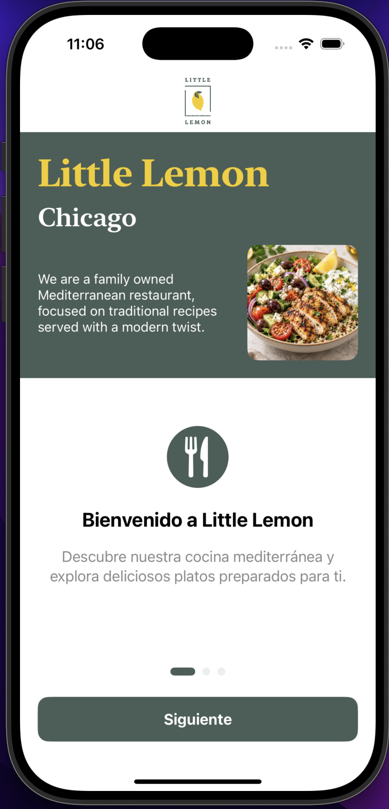
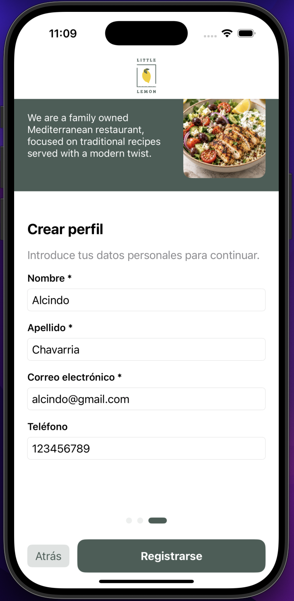
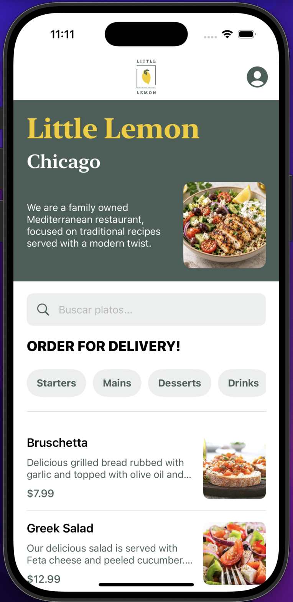
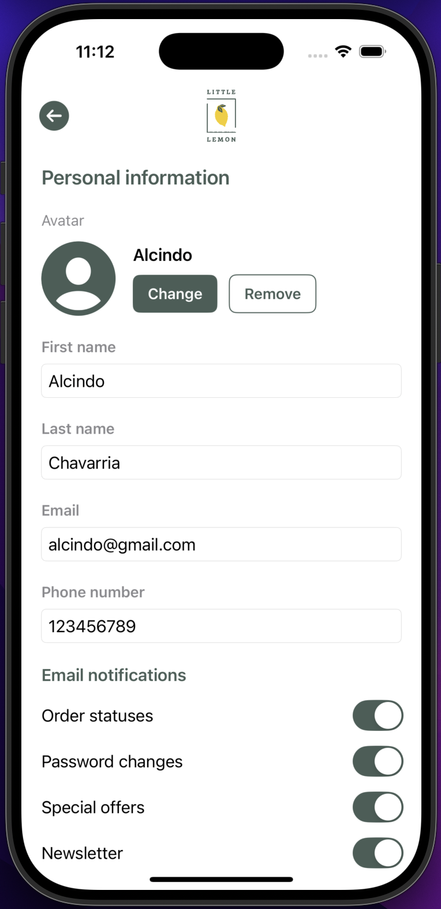
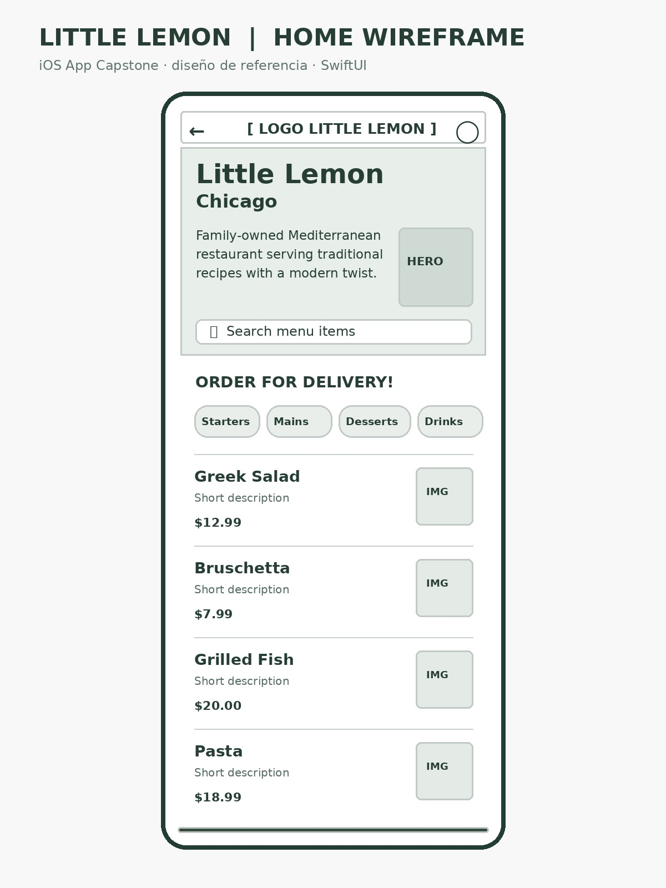

<div align="center">

# 🍋 Little Lemon Food Ordering

### Aplicación iOS de pedidos de comida mediterránea

Proyecto final del curso **iOS App Capstone de Meta**, desarrollado con SwiftUI.

Aplicación móvil que permite explorar el menú del restaurante Little Lemon, buscar platos, filtrar por categorías y administrar un perfil de usuario.

### 🛠️ Stack tecnológico


**SwiftUI · MVVM · Core Data · URLSession · UserDefaults · PhotosUI**

</div>

---

## 📖 Descripción

**Little Lemon Food Ordering** es una aplicación iOS desarrollada con SwiftUI como parte del proyecto final del certificado profesional de desarrollo iOS de Meta en Coursera.

La aplicación permite consultar los platos del restaurante Little Lemon mediante una API REST, realizar búsquedas por nombre, filtrar por categorías y administrar los datos personales del usuario.

Utiliza Core Data para almacenar localmente los platos y UserDefaults para conservar la información del perfil.

## ✨ Funcionalidades

- Onboarding interactivo de tres pantallas.
- Registro y validación de datos personales.
- Consumo de API REST mediante URLSession.
- Almacenamiento local utilizando Core Data.
- Búsqueda de platos por nombre.
- Filtrado por categorías del menú.
- Visualización de imágenes, descripciones y precios.
- Edición de información personal.
- Selección y eliminación de fotografía de perfil.
- Gestión de preferencias de notificaciones.
- Guardado y descarte de cambios.
- Cierre de sesión.

## 🏗️ Arquitectura

El proyecto utiliza el patrón **MVVM (Model-View-ViewModel)** para organizar el código y separar responsabilidades.

| Capa | Responsabilidad |
|------|-----------------|
| Models | Representación de los datos |
| Views | Interfaces desarrolladas con SwiftUI |
| ViewModels | Estado y lógica de presentación |
| Services | Comunicación REST y almacenamiento del perfil |
| Persistence | Persistencia local mediante Core Data |
| Assets | Recursos gráficos de la aplicación |

## 🌐 API REST

La aplicación recupera los elementos del menú desde la API proporcionada por Meta.

**Endpoint:**

https://raw.githubusercontent.com/Meta-Mobile-Developer-PC/Working-With-Data-API/main/capstone.json

Los datos obtenidos se procesan mediante `JSONDecoder` y se almacenan localmente utilizando Core Data.


## 📱 Capturas de pantalla

<div align="center">

| **Pantalla de bienvenida** | **Registro de usuario** |
|:---:|:---:|
|  |  |
| **Menú principal** | **Perfil de usuario** |
|  |  |

</div>


## 🎨 Wireframe

El diseño inicial de la pantalla principal se encuentra disponible en la carpeta `Design`.

<div align="center">



</div>

## 🚀 Instalación y ejecución

### Requisitos

- macOS
- Xcode compatible con SwiftUI
- Simulador iOS
- Conexión a Internet para obtener inicialmente el menú

### Pasos

**1. Clonar el repositorio**

```bash
git clone https://github.com/onechavarria/LittleLemonFoodOrdering.git
```

**2. Entrar al proyecto**

```bash
cd LittleLemonFoodOrdering
```

**3. Abrir el proyecto en Xcode**

```bash
open LittleLemonFoodOrdering.xcodeproj
```

**4. Ejecutar**

- Seleccionar un simulador de iPhone.
- Compilar mediante `Command + B`.
- Ejecutar mediante `Command + R`.

## 🧪 Pruebas funcionales

La aplicación permite verificar el proceso de registro, navegación, búsqueda, filtrado, persistencia de información y gestión del perfil.

Las funcionalidades pueden probarse utilizando el simulador de iOS desde Xcode.

## 📚 Contexto académico

Proyecto desarrollado para la evaluación final del curso **iOS App Capstone**, perteneciente al programa **Meta iOS Developer Professional Certificate** en Coursera.

## 👨‍💻 Autor

**Alcindo Chavarría**

Proyecto académico desarrollado con Swift y SwiftUI.

---

<div align="center">

**🍋 Little Lemon Food Ordering — iOS App Capstone**

</div>
